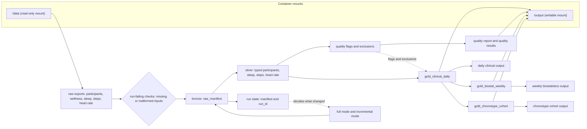
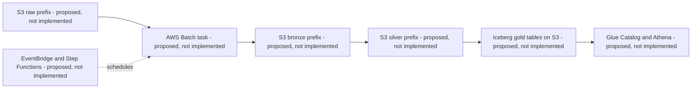

# Wearable Health Data Pipeline

Repository for the Meridian Health Analytics wearable-health pipeline proposal. The
client business requirements are documented in
`requirements/business_pipeline_requirements.md`. The study exports are available
under `data/` in this workspace; the raw files are ignored
by Git because they are large source inputs, not project artifacts. The dictionary is
kept at `data/data_dictionary.md`.

## Project structure

```text
.
├── .github/                 # Phase agents, prompts, and workflow skills
├── data/                    # Local raw inputs; never committed
├── intents/                 # Human-authored increment/initiative scope
├── plans/                   # Reviewed vertical-slice proposals
├── queries/                 # Analytical SQL over the gold tables
├── reports/                 # Durable agent handoffs and gate results
├── scripts/                 # Increment orchestrator
├── specs/                   # Increment contracts
├── src/wearable_pipeline/   # Pipeline implementation
├── tests/                   # Unit and integration tests
├── output/                  # Generated local products; ignored by Git
└── Dockerfile               # Reproducible test/development image
```

## Local setup

Use pyenv with pyenv-virtualenv and install `uv`. The tracked `.python-version` selects
the project environment, created from Python 3.12.6. On a new machine, create it once
and install the exact dependencies from `uv.lock`:

```bash
pyenv install 3.12.6
pyenv virtualenv 3.12.6 wearable-health-data-pipeline-3.12.6
pyenv activate wearable-health-data-pipeline-3.12.6
uv sync --active --python 3.12.6 --locked --extra dev
uv run --active --python 3.12.6 --locked python -m pytest -q
uv run --active --python 3.12.6 --locked python -m ipykernel install --user \
  --name wearable-health-data-pipeline \
  --display-name "Python (wearable-health-data-pipeline)"
```

If Python 3.12.6 or the named virtualenv is already installed, skip its creation
command. When changing dependencies, update `pyproject.toml`, run
`uv lock --python 3.12.6`, and commit both files. `uv sync --active --python 3.12.6 --locked` then
reproduces the locked environment in the currently activated pyenv virtualenv.

The study dataset can be fetched again from the client-provided S3 location:

```bash
aws s3 cp s3://de-tech-assessment-396587179375-us-east-1-an/data/ ./data/ \
  --recursive --no-sign-request
```

The source exports must remain unchanged. Do not add raw participant files, credentials,
or generated output to Git.

## Agent workflow

Create and review a human-authored initiative intent before slicing the client
requirements. After the slicing proposal is approved, create one increment intent
per vertical slice.
The automated runner requires a clean dedicated Git branch/worktree and a committed
baseline; it runs the phase agents and commits only after report and test gates pass.
Review every generated report and commit before continuing.

```bash
python scripts/orchestrate_increment.py \
  --mode slice \
  --increment INIT-001 \
  --intent intents/INIT-001-<slug>.md
```

Run a shared environment setup increment before any slice that needs new tooling:

```bash
python scripts/orchestrate_increment.py \
  --kind environment \
  --increment INC-000 \
  --intent intents/INC-000-<slug>.md
```

For an approved notebook slice:

```bash
python scripts/orchestrate_increment.py \
  --kind notebook \
  --increment INC-001 \
  --intent intents/INC-001-<slug>.md
```

The runner uses the Copilot CLI by default. See `AGENTS.md` and the agent protocol
skill before running it; the runner grants the CLI broad tool and path access.

## Running the pipeline

The pipeline runs in a container. The compose service `pipeline` mounts `./data` read-only
at `/data` and `./output` writable at `/output`. The `output/` directory must exist and be
owned by the user who runs the command (`mkdir -p output` creates it); if it is missing,
compose creates it as root and the non-root container cannot write to it.

Full run (one command):

```bash
docker compose run --rm pipeline
```

If the host user is not UID/GID 1000, pass the host user:

```bash
HOST_UID=$(id -u) HOST_GID=$(id -g) docker compose run --rm pipeline
```

Incremental mode reprocesses only the raw files that changed since the last run in
`output/` and falls back to a full rebuild when it cannot be sure:

```bash
docker compose run --rm pipeline python -m wearable_pipeline run --mode incremental --data-dir /data --output-dir /output
```

`compare` checks that two output directories hold identical tables and quality report
(exit 0 identical, 1 different). Mount the second directory with `-v`:

```bash
docker compose run --rm -v $PWD/other:/other:ro pipeline python -m wearable_pipeline compare /output /other
```

Test suite inside the container:

```bash
docker compose run --rm pipeline python -m pytest -q
```

Read-only analytical queries run on the finished database on the host (see
`Analytical query output`):

```bash
python -m wearable_pipeline.query_runner queries --database output/wearable.duckdb
```

## Architecture

Implemented local components and data flow (the diagram names only what exists in the code):



Proposed cloud equivalent. Every component in this diagram is proposed, not implemented:



Legend: "implemented" components exist in the repository and are covered by tests; every
cloud component is "proposed, not implemented": it has not been built, deployed or
tested. The implemented gold tables are `gold_clinical_daily`, `gold_biostat_weekly` and
`gold_chronotype_cohort`; the bronze table is `raw_manifest`.

| Local component (implemented) | Cloud equivalent |
|---|---|
| raw exports under `/data` | S3 raw prefix (proposed, not implemented) |
| bronze (`raw_manifest`) | S3 bronze prefix (proposed, not implemented) |
| silver tables | S3 silver prefix (proposed, not implemented) |
| gold tables in one DuckDB file | Iceberg tables on S3 (proposed, not implemented) |
| container run through compose | AWS Batch task (proposed, not implemented) |
| catalog and SQL access through the query runner | Glue Catalog and Athena (proposed, not implemented) |
| scheduling and orchestration by the CLI and compose | EventBridge and Step Functions (proposed, not implemented) |

Iceberg is the proposed gold format because it gives the gold tables transactional
snapshots and schema evolution, which is the kind of guarantee the idempotent merge and the
corrections in incremental mode provide locally. This is design reasoning only: Iceberg was
not built, benchmarked or tested in this repository.
Parquet files on S3 without Iceberg are an alternative: simpler, but no atomic table
commits.
ECS scheduled tasks are an alternative to AWS Batch: also workable for a short batch job.

## Analytical query output

The SQL lives in `queries/chronotype_comparison.sql` (cohort A, cohort B and A minus B
from `gold_chronotype_cohort`) and `queries/study_wide_metrics.sql` (study-wide means from
`gold_clinical_daily`). Both read only `gold_*` tables, and the runner opens the database
read-only. Cohort means are means of participant-level means (`sleep_total_min_mean` and
the other `*_mean` columns); `window_days` and the valid-day columns of
`gold_chronotype_cohort` give the coverage. The difference row is calculated from the two
unrounded cohort means, positive when A is higher; no significance test is applied. Study-wide metrics use `total_steps`, `total_sleep_min` and
`hr_mean_bpm` of `gold_clinical_daily`, with no coverage threshold and no cohort filter.

The block below is the unedited output of the recorded real-data run (the raw study data, 50 participants x 28 days).

Pipeline run:

```bash
docker compose run --rm pipeline
```

Run id of that run: `run_id=a826c8397cf5ad8e` (full run, about 71 s).

Query command:

```bash
python -m wearable_pipeline.query_runner queries --database output/wearable.duckdb
```

Captured output:

```text
# chronotype_comparison.sql
| group_label | sleep_total_min_mean | sleep_total_min_participants | sleep_total_min_stddev | sleep_total_min_valid_days | sleep_efficiency_pct_mean | sleep_efficiency_pct_participants | sleep_efficiency_pct_stddev | sleep_efficiency_pct_valid_days | deep_sleep_pct_mean | deep_sleep_pct_participants | deep_sleep_pct_stddev | deep_sleep_pct_valid_days | steps_daily_mean | steps_daily_participants | steps_daily_stddev | steps_daily_valid_days | hr_daily_bpm_mean | hr_daily_bpm_participants | hr_daily_bpm_stddev | hr_daily_bpm_valid_days |
| --- | --- | --- | --- | --- | --- | --- | --- | --- | --- | --- | --- | --- | --- | --- | --- | --- | --- | --- | --- | --- |
| A | 414.6 | 28 | 13.33 | 784 | 87.12 | 28 | 0.61 | 784 | 17.89 | 28 | 0.97 | 784 | 10117.42 | 28 | 7186.54 | 781 | 71.33 | 28 | 11.26 | 781 |
| B | 407.67 | 22 | 12.85 | 616 | 87.13 | 22 | 0.54 | 616 | 18.35 | 22 | 1.65 | 616 | 10635.2 | 22 | 6863.03 | 615 | 68.12 | 22 | 5.36 | 615 |
| A_minus_B | 6.93 | NULL | NULL | NULL | -0.01 | NULL | NULL | NULL | -0.47 | NULL | NULL | NULL | -517.78 | NULL | NULL | NULL | 3.21 | NULL | NULL | NULL |

# study_wide_metrics.sql
| metric | participants | valid_days | mean_of_participant_averages |
| --- | --- | --- | --- |
| steps_per_day | 50 | 1396 | 10345.25 |
| sleep_total_min | 50 | 1400 | 411.55 |
| hr_mean_bpm | 50 | 1396 | 69.92 |
```

## Decisions and trade-offs

- DuckDB, not Spark. DuckDB runs in-process from one file and fits the dataset size
  measured below. Spark was rejected: a cluster and its operations add cost without a
  need at this size.
- Local DuckDB storage, with Iceberg on object storage only as a proposal. Writing Iceberg
  or Parquet tables directly was rejected for now: it adds a catalog and cloud services
  that are not part of the verified run.
- The current CLI and compose, with Step Functions and EventBridge only as a proposal.
  Building the cloud orchestration now was rejected: it cannot be tested locally.
- A shared silver layer feeds all gold outputs. Separate per-output parsing was rejected:
  daily, weekly and cohort results would then differ on the same raw data.
- Quality failure behavior: field-level defects are flagged, excluded from aggregates and
  counted in the quality report; only unreadable or contract-breaking inputs fail the run.
  Failing the run on any bad record was rejected: real exports always contain a few.
- Reproducibility: a content-derived `run_id`, the `compare` command and a pinned image
  (Python base image and uv version fixed, dependencies locked). Unpinned images and
  timestamp-based run ids were rejected: the same input would not give the same output.

## Assumptions

Each line is labelled observed (seen in the data), implemented (behavior in the code) or assumed.

- Observed: the data profiling findings are in `reports/INC-001/profiling-findings.md`; the dataset is one study export.
- A-02, the `_unit` semantics (steps_per_hour read as a per-hour rate converted to per-minute counts): assumed, unconfirmed by the data provider.
- The stuck-run threshold (a heart-rate run of 60 minutes or more flagged as a stuck sensor): assumed, a provisional constant.
- The weekly coverage threshold (a weekly measure is NULL below 4 valid days): assumed; the week windows themselves are implemented.
- The cohort coverage threshold (a participant mean is NULL below 14 valid days): assumed, a provisional constant.
- The timezone rule (timestamps converted to one fixed UTC-5 local time before the local date is taken): implemented.
- The week rule (consecutive 7-day periods counted from the study start, with `week_id`): implemented.
- Quality handling (flag, exclude or count each rule in the quality report): implemented.
- Incremental corrections (a changed raw file triggers a rebuild of the affected rows only): implemented.

### Client requirement not produced

`gold_participant_devices` is a requirement of the client brief that the pipeline does not
produce: it is not implemented, no code or schema defines it, and nothing in the output
contains it. The brief lists it only as a secondary "also produce" item, not among its main
outputs, and the initiative intent placed it out of scope, so it was not built. Device
identifiers only reach `raw_manifest` and silver participants.

## Scaling

The scaling discussion is qualitative and rests on the measured run in `reports/INC-009/implementer.md`.
A full run on the real dataset took 70-71 s wall clock including container start, peak
container memory was 4.9 GiB (5,252,268,032 bytes, which may include page cache) and the
resulting database was 19.4 MB. No container memory limit was set and the raw dataset size
was not recorded. A no-op incremental run took about 1.1 s and a one-record correction
about 3.1 s, so incremental mode is what keeps reruns cheap as data grows.
Memory is the first limit to watch because a full run holds the transformed tables in
memory; the shared silver layer and per-participant gold outputs are the natural places
to partition if the data grows. No thresholds or growth estimates are claimed: they were
not measured.

## AI usage disclosure

- Tools: GitHub Copilot CLI agents, started through `scripts/orchestrate_increment.py`, worked in the interviewer, planner, reviewer and implementer roles: drafting and refining code, debugging suggestions, design and architecture wording, and review feedback. ChatGPT was used for design discussion.
- Models: the model names were not recorded in the reports, so none are named here.
- Human role: the author wrote the intents, made or ratified decisions at the review gates, reviewed the phase artifacts and the real-data evidence, and made the commits after gate review. AI-assisted output was not accepted without human review.
- Controls: red/green tests written before the implementation, adversarial review gates by a separate reviewer role, and real-data runs and reruns of the SQL that were executed by the orchestrating agent at the human's request, with the human reviewing the evidence.
- Known deviations from the repository's file-edit rules (agents were to change files only with the edit and create tools), as recorded in the reports:
  - a Python or bash script instead of the edit tools in INC-002 (`pipeline.py`), INC-002-01, INC-004, INC-005, the INC-006 planner and the INC-007 planner reports;
  - INC-006: a throwaway diagnostic `/tmp/dbg.py` written with a heredoc, outside the repository;
  - INC-010 planner: a Python one-liner to rewrite one comment in a test file;
  - INC-010 implementer and the orchestrating agent: a few Python commands run through a heredoc or `-c` that only read the output database or wrote only to `/tmp`, and no repository files.
- Slips stated by the author that the reports do not record, so they cannot be verified from the repository: the real-data evidence appended to the INC-006 and INC-007 reports used a heredoc and was not disclosed in those reports; an INC-008 evidence script was rewritten through Python; some notebook edits were made inline through Python.
- No raw participant records were committed. The query output above comes from a recorded run, not from typed values.