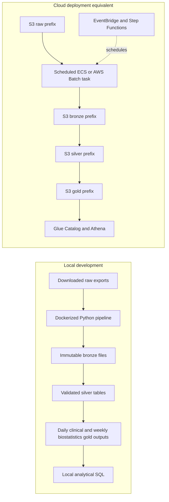

# Wearable Health Data Pipeline

Starter repository for the Meridian Health Analytics data engineering challenge. The
study exports are available under `data/` in this workspace; the raw files are ignored
by Git because they are large source inputs, not project artifacts. The dictionary is
kept at `data/data_dictionary.md`.

## Project structure

```text
.
├── .github/                 # Phase agents, prompts, and workflow skills
├── data/                    # Local raw inputs; never committed
├── intents/                 # Human-authored increment/initiative scope
├── plans/                   # Reviewed vertical-slice proposals
├── reports/                 # Durable agent handoffs and gate results
├── scripts/                 # Increment orchestrator
├── specs/                   # Increment contracts
├── src/wearable_pipeline/   # Pipeline implementation
├── tests/                   # Unit and integration tests
├── output/                  # Generated local products; ignored by Git
└── Dockerfile               # Reproducible test/development image
```

## Local setup

Use pyenv with pyenv-virtualenv and install `uv`. The tracked `.python-version` selects
the project environment, created from Python 3.12.6. On a new machine, create it once
and install the exact dependencies from `uv.lock`:

```bash
pyenv install 3.12.6
pyenv virtualenv 3.12.6 wearable-health-data-pipeline-3.12.6
pyenv activate wearable-health-data-pipeline-3.12.6
uv sync --active --python 3.12.6 --locked --extra dev
uv run --active --python 3.12.6 --locked python -m pytest -q
```

If Python 3.12.6 or the named virtualenv is already installed, skip its creation
command. When changing dependencies, update `pyproject.toml`, run
`uv lock --python 3.12.6`, and commit both files. `uv sync --active --python 3.12.6 --locked` then
reproduces the locked environment in the currently activated pyenv virtualenv.

The dataset is publicly readable from the challenge bucket if it needs to be fetched
again:

```bash
aws s3 cp s3://de-tech-assessment-396587179375-us-east-1-an/data/ ./data/ \
  --recursive --no-sign-request
```

The source exports must remain unchanged. Do not add raw participant files, credentials,
or generated output to Git.

## Agent workflow

Create and review a human-authored initiative intent before slicing the whole challenge.
After the slicing proposal is approved, create one increment intent per vertical slice.
The automated runner requires a clean dedicated Git branch/worktree and a committed
baseline; it runs the phase agents and commits only after report and test gates pass.
Review every generated report and commit before continuing.

```bash
python scripts/orchestrate_increment.py \
  --mode slice \
  --increment INIT-001 \
  --intent intents/INIT-001-wearable-health-pipeline.md
```

For an approved slice:

```bash
python scripts/orchestrate_increment.py \
  --increment INC-001 \
  --intent intents/INC-001-example-slice.md
```

The runner uses the Copilot CLI by default. See `AGENTS.md` and the agent protocol
skill before running it; the runner grants the CLI broad tool and path access.

## Proposed architecture

The exact storage and orchestration choices should be confirmed in the initiative
plan. This local-to-cloud mapping is the starting proposal, not an implemented stack:



Quality checks belong at ingestion and transformation boundaries: malformed or
unmatched records are counted and reported, while explicit business rules govern
whether suspect measurements are quarantined, flagged, or excluded from aggregates.
Daily and weekly outputs should derive from the same validated source of truth.

## Challenge deliverables

The implementation must include daily clinical outputs, weekly biostatistics outputs,
chronotype cohort metrics, and `gold_participant_devices`. The final README should
document measured data issues, quality rules, table grains, idempotency, operational
trade-offs, analytical query output, and the final architecture.

## AI usage disclosure

GitHub Copilot assisted with adapting the repository harness, creating this project
scaffold, and proposing the initial architecture. Review and validate generated
artifacts before use. No raw participant records were inspected during scaffolding.